# Chapter map

One row per chapter: what it explains, where that lives in shilp, and how much of it shilp already has.

Status key: have shilp already does this and the chapter is confirmation; partial the mechanism exists in a smaller form; gap shilp does not do this, and the chapter is the specification for adding it.

| Ch | Topic | Lands in | Status | What reading it changes |
| --- | --- | --- | --- | --- |
| 1 | Serving and optimisation | `README.md`, `cli.py` | have | Vocabulary for the four steps; confirms the lifecycle framing |
| 2 | LLM serving | `engine/llamacpp.py`, `engine/template.py`, `00-theory` | have | The derivation behind the prefill/decode asymmetry shilp measures |
| 3 | System design | `server/generate.py`, `server/stream.py`, `server/app.py` | partial | Single-model service is built; multi-model and Triton are not |
| 4 | Best practices | `05-deploy.md`, `web/` | partial | Enterprise architecture and build-or-buy framing for the deploy docs |
| 5 | Challenges | `doctor`, `README` numbers | have | Arithmetic intensity, KV sizing, GPU specs — the maths behind the tables |
| 6 | Essential techniques | `modify/quantize.py`, `engine/loader.py` | gap | Quantisation exists; continuous batching and RadixAttention do not |
| 7 | Advanced techniques | `08-service-roadmap.md` | gap | The post-single-box story: speculative decoding, parallelism, disaggregation |
| 8 | Frameworks | `engine/base.py` protocol | partial | llama.cpp is done; vLLM, SGLang, TensorRT-LLM backends are one file each |
| 9 | In practice | `recipes/`, `make loadtest` | partial | A validated ordering for benchmark → quantise → distribute |
| 10 | Advancements | `modify/merge.py`, `telemetry.py` | gap | Multi-LoRA serving, semantic caching, profiling, multimodal |

## Reading order, by what it unlocks

If you are reading to improve shilp rather than to learn the field, the highest-value order is not the book's.

```mermaid
flowchart LR
    A["5 · Challenges<br/>the arithmetic"] --> B["2 · Serving<br/>KV cache, prefill/decode"]
    B --> C["6 · Essential<br/>batching, quantisation"]
    C --> D["3 · System design<br/>single + multi model"]
    D --> E["8 · Frameworks<br/>which backend next"]
    E --> F["7 · Advanced<br/>parallelism, disaggregation"]
    F --> G["9 · In practice<br/>the end-to-end plan"]
    G --> H["10 · Advancements<br/>LoRA, caching, profiling"]
```

Start at 5 rather than 1. The arithmetic in Chapter 5 is what makes Chapter 2's KV cache section quantitative instead of descriptive, and it is what lets you predict, rather than measure, why four concurrent streams stagger by 1.6 seconds each.

## Three clusters

**The confirmation cluster — 1, 2, 5.** shilp already implements these and documents the reasoning. Read them to check your understanding, not to find work. If something here surprises you, the shilp docs are probably wrong somewhere and worth fixing.

**The specification cluster — 3, 6, 7, 8.** These chapters describe mechanisms shilp either lacks or has only in a degenerate form. Continuous batching (Ch 6) is the big one: `llama-cpp-python` is single-sequence, so requests serialise, and the load test shows exactly that. Chapter 8 is the guide to writing the next engine backend correctly rather than by guesswork.

**The direction cluster — 4, 9, 10.** Not urgent, but they decide what shilp becomes: a team server with auth and admission control, or a learning stack that stops at one box and says so. Chapter 9 is also the best template for turning `recipes/*.json` into a record of measured deltas rather than a list of steps.

## Where shilp contradicts the book, on purpose

The book assumes a cluster and a multi-tenant service. shilp assumes one box, one resident model, one mutable KV cache. Both are legitimate positions, and the difference is worth being articulate about:

- **One model resident, LRU eviction.** shilp's loader keeps one model in memory and evicts on switch. The book's Chapter 3 multi-model service keeps several and routes between them. shilp's choice is why `shilp ps` is short and why swapping models is slow.
- **Requests take turns.** Deliberate. The README says so, the load test proves it, and the fix is named: `llama-server --parallel N` on the same GGUF files, or vLLM on a CUDA box.
- **No auth, no quotas, no metering.** Because it binds to `127.0.0.1` and is a learning stack. The book's Chapter 4 and the `system-design/` docs are where that would change.

When a chapter note says "shilp does not do this", it is usually this difference and not an oversight. [What shilp does not do](../gaps/serving-gaps.md) lists each one with its reason.
